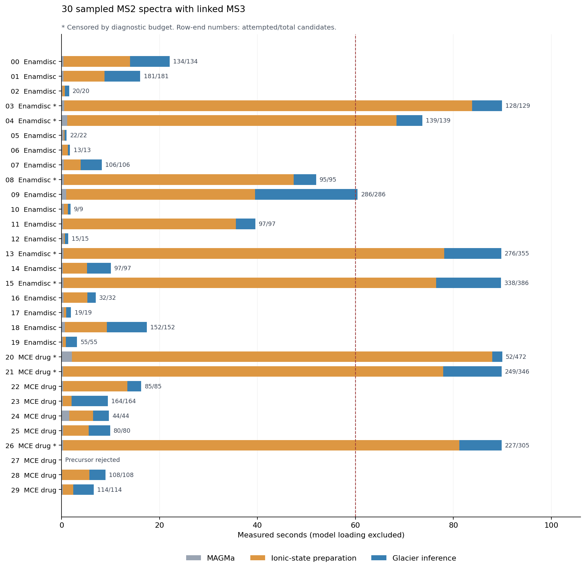

# Random MS2 → MAGMa → Glacier diagnostic experiment

The missing predictions and long waits have different causes. Some candidate
graphs cannot satisfy the adapter's declared formula, hydrogen and charge
constraints. Others require substantial state enumeration before Glacier runs.
Rejecting an impossible assignment within this domain can be very fast; a
successful candidate can be expensive.

This experiment investigates availability and runtime. A valid representation
and finite model output do **not** establish that the candidate is the actual
fragment or that its prediction accurately matches MS3.

## Method and scope

[The harness](../stress_pipeline.py) executes the existing definition cells from
[Experiment_1.ipynb](../../Experiment_1.ipynb), without editing production behavior.
It selects 30 MS2 spectra: 20 ENAMDISC and 10 MCEDRUG, using seeds 20260922 and
20260923. It shuffles eligible scan records, retains one MS2 per feature/SMILES
group, and verifies actual MS3 children. Groups with more eligible scans have
more chances to enter this sample; this is not uniform molecule sampling.

Only `SINGLE_BEST_SCAN` records participate. Unsupported adducts remain eligible.
[cohort.json](cohort.json) saves identities and source offsets.

MAGMa uses notebook defaults, followed by the existing same-formula bag filter.
Every remaining candidate is attempted, including bags without linked MS3, to
reflect the notebook workload. MS3 does not select ionic states. Glacier is loaded
once with both recovery flags enabled, `max_states=4`, instrument `Orbitrap`, and
model collision energy 60, without claiming calibrated acquisition-energy equivalence.
[run_settings.json](run_settings.json) records the checkpoint/source identities,
notebook hash, interpreter and configuration.

The harness times generation, preparation and prediction separately, saving graphs,
state audits and output hashes. Output checks require nonempty, finite, normalized
spectra. Plotting and mixture fitting are measured separately.

Diagnostic deadlines are 45 seconds for generation, 12 seconds per preparation or
prediction phase, and 90 seconds per spectrum. `ProbeTimeout` means an interrupted,
censored observation—not chemical rejection. A spectrum marked `complete` may
still contain individual candidate timeouts; a spectrum timeout can also leave
candidates untested. These categories must remain separate in coverage totals.

## Results

<!-- FINAL_RESULTS_START -->
All 30 spectra were processed: **23 completed iteration, six reached the 90-second
deadline, and one failed precursor validation**. Generation produced 4,375 raw
candidates across 29 spectra; formula filtering retained 4,060. Of these, 3,337
were attempted and 723 remained untested.
The rejected precursor has no known candidate total.

| Attempted-candidate outcome | Count |
|---|---:|
| Finite normalized prediction | 2,930 |
| Exhausted closed-shell domain | 322 |
| Exhausted one-radical domain | 59 |
| Internal leaf budget exhausted (`search_incomplete`) | 4 |
| Diagnostic preparation timeout | 22 |

There were no invalid model outputs or candidate inference exceptions. Recovery
enabled 458 radical and six aromatic predictions beyond baseline support; this
measures representation coverage, not predictive accuracy.

Among 618 attempted candidates with linked MS3, 567 predicted, 50 were unavailable
and one timed out. In the 23 fully iterated spectra, **78 of 79 MS3-linked bags**
had at least one prediction; one bag had none. Across all bags in those spectra,
377 of 383 had a prediction. Censored spectra additionally contain six wholly
unattempted MS3-linked bags; their availability remains unknown.

Eight spectra exceeded one minute, including the six interrupted runs. The 23
completed-iteration times ranged 1.04–73.69 seconds, median 9.50 seconds. Measured
totals were **749.7 seconds preparation**, 154.3 seconds prediction and 14.5 seconds
generation. Successful candidate prediction median/max were 0.053/0.132 seconds.
All 22 candidate deadlines occurred during preparation.

These are descriptive, scan-weighted sample results, with interrupted work included
in time totals. Deadlines hide full runtimes and eventual outcomes. Complete
counts and timings are in [summary.json](summary.json) and [timings.csv](timings.csv).
<!-- FINAL_RESULTS_END -->

## What “no valid state” means

The [baseline enumerator](../../distilled_fragdata/src/chemistry/_enumeration.py)
preserves the heavy graph, bond orders, aromatic labels and total formula. It
requires net charge +1 and a closed shell. Allowed atom-local charges are −1, 0,
or +1; allowed total absolute charge is 1, 3, 5, or 7. Element-specific valence/H
templates are defined in
[_state_graph.py](../../distilled_fragdata/src/chemistry/_state_graph.py).

`no_valid_state_in_declared_domain` means the declared search was exhausted.
`search_incomplete` means a budget prevented completion. Successful results can
also be truncated: `feature_selection_capped` identifies capped retention, distinct
from a search budget.

MAGMa's mass match combines an induced heavy graph with a global hydrogen-shift
hypothesis. Matching mass does not guarantee that the assigned formula is
realizable on the inherited bond orders.

[domain_examples.json](domain_examples.json) records four local-domain counterexamples
and one budget example:

| Saved location | Formula; observed m/z | Local-domain proof |
|---|---|---|
| Spectrum 00, bag 16, candidate 4 | C10H9F2; 167.066848 | H=9, net +1 requires total absolute charge 9; the allowed maximum is 7. |
| Spectrum 01, bag 9, candidate 1 | C3H2N3O; 96.019256 | Three terminal nitrogens require at least three H regardless of net charge; net +1 requires at least six. The formula has two. |
| Spectrum 02, bag 4, candidate 0 | C12H4ClNO; 213.000823 | Even allowing exactly one radical, H=4/net +1 requires total absolute charge 11. |
| Spectrum 06, bag 0, candidate 0; **linked MS3 present** | C7H7; 91.055503 | The fixed graph requires at least nine H, including at net +1; the formula has seven. |

These four exhausted the domain with zero checked leaves; each enumeration took
under 1 ms. Another
candidate in the fourth example's bag succeeds as `[CH2+]c1ccccc1`: the failure
concerns the graph, not C7H7 alone. Across the cohort, all 322 closed-shell and
56 of 59 radical domain failures had zero leaves; three radical failures instead
exhausted assignments with sanitization/graph rejections.

Reproduce these proofs from the repository root:

```bash
.venv/bin/python recovery_lab/explain_stress_failures.py
```

[The probe](../explain_stress_failures.py) combines existing local domains without
an absolute-charge cap and computes minimum H. It performs no inference or
sanitization; reachability at absolute charge 9 or 11 does not prove plausibility.

The [adapter's recovery routes](../../distilled_fragdata/src/chemistry/fragment_adapter.py)
remain deliberately separate. Radical recovery runs after odd-electron parity
rejection and requires exactly one radical. Aromatic recovery runs after the
specified closed-shell domain failure and may relax inherited aromatic labels.
Neither changes arbitrary nonaromatic bonds, and the routes do not chain. All
four local-domain examples above have no aromatic edges.

## Budget and precursor failures are different

In [spectrum 20](spectrum_20.json), bag 8/candidate 1, C17H13N5O2 at m/z 319.105041,
radical enumeration spent 2.435 seconds checking 20,000 assignments. All changed
the required heavy graph/aromaticity after sanitization. The leaf cap stopped
search, so `search_incomplete` correctly leaves existence unresolved. All four
cohort cases with this reason hit that cap; this is separate from the 22 external
diagnostic timeouts.

[Spectrum 27](spectrum_27.json) fails before MAGMa because its adduct is
`[M+H-H2O]+`; generation supports `[M+H]+` and `[M]+`. Relabeling it protonated
would misrepresent the missing water and precursor mass. Supporting it requires
a defined dehydrated precursor graph, including which atoms/bonds change.

## Why four retained states can still take a long time

`max_states=4` caps final retention, not enumeration. Before selecting states, the
search explores its minimum successful charge family, potentially checking
20,000 complete assignments, collecting 512 chemical states, or visiting 250,000
DP/search nodes. Every complete assignment can require RDKit sanitization and
graph validation. There is no production wall-clock deadline.

For a concrete completed case, spectrum 11, bag 18, candidate 0 (C5H6N5,
m/z 136.061691) spent about 4.65 seconds rejecting 4,758 baseline assignments;
aromatic recovery then took about 0.068 seconds. Its four-state model prediction
took about 0.051 seconds. The saved baseline and recovery metadata distinguish
these costs in [spectrum_11.json](spectrum_11.json).

The notebook then predicts each retained state sequentially and averages the
normalized spectra. Hundreds of candidates accumulate preparation and inference
cost. The current path has no persistent state/prediction cache. Filtering only
the final plot does not avoid predictions already computed for hidden bags.

## Follow-up performance measurements

[The isolated follow-up](quick_wins.json) predicted only bags with linked MS3,
using the unchanged notebook function and model settings:

| Spectrum | All / MS3-only candidates | All-bag preparation + inference | MS3-only preparation + inference |
|---|---:|---:|---:|
| 00 | 134 / 20 | 21.66 s | 3.94 s |
| 03 | 129 / 8 | 89.39 s, interrupted | 0.74 s |

All **28 retained predictions matched their original SHA-256 hashes exactly**.
Generation was measured separately: 0.38 and 0.53 seconds in these follow-ups.
Across the original cohort, 88% of measured preparation/inference time went to
bags without linked MS3. The plot's `only_with_ms3=True` alone does not save that
work; select the subset **before** prediction:

```python
comparison_bags = [bag for bag in filtered_bags if bag[2]]
predictions = predict_candidate_bags(model, comparison_bags, collision_energy=60)
plot_fragments_with_spectra(comparison_bags, predictions, only_with_ms3=True)
```

A same-model in-memory cache demonstration returned exact copied outputs in
1.26 ms and 0.39 ms. These are lookup/copy timings **after population**, not cold
prediction times; no production cache was installed. Only three exact stripped
inputs repeated within the cohort, so whole-candidate caching mainly helps
notebook reruns here, rather than first-time distinct spectra.

Generating gallery HTML took 0.20–0.75 seconds without mixture fitting
and 0.22–0.63 seconds with fitting (one and four actual mixture cards). The first
plot was colder; these timings do not establish that mixtures make rendering
faster. Browser rendering and other energy/display configurations were not timed.

[Replaying one timed-out candidate](slow_case_replay.json), spectrum 03/bag 15/
candidate 57, succeeded in **14.86 seconds** under the original chemistry limits.
It checked 20,000 assignments: 15,362 failed sanitization, 4,144 changed the graph
or aromaticity, and 494 were chemically retained before selecting four model
states. It still stopped at the leaf budget. A second, profiled run retained the
identical four states; [the profile](slow_case_profile.txt) attributes 15.29 of
15.32 seconds to the recursive enumeration routine. It does not separately time
individual native RDKit operations. The original 12-second timeout was therefore
not evidence of an unrepresentable molecule.




## Additional mixture warning

The gallery follow-up emitted NumPy `matmul` overflow/invalid warnings. A separate
[one-bag audit](mixture_audit.json) reproduced them with actual inputs at
m/z 147.091308. All inputs and results were finite: matrix entries were at most
0.170, and normalized candidate columns summed to one. Repeating the original
fit gave identical outputs. An isolated version replacing the explicit matrix
products with non-BLAS `einsum` emitted no warnings, kept the weights and cosine
exact, and changed mixed intensities by at most 1.735 × 10⁻¹⁸.

This supports a spurious numerical-status warning for this case rather than
actual overflowing intensities. NumPy 2.2.6 uses Apple Accelerate here; the precise
backend cause is unproven. The tested workaround is a small numerical implementation
change, independent of Glacier chemistry/weights, but was not installed in
production. [Saved arrays](mixture_audit_inputs.npz) allow reproduction without
guessing inputs. This finding concerns one mixture, not all possible warnings.

## What can be fixed quickly, and what needs design

Straightforward engineering work includes reporting stage progress and precise
failure reasons, predicting only the requested MS3-linked subset, and caching
identical preparations/predictions. Cache identity must cover the graph/formula,
mass validation, model/checkpoint, recovery flags, enumeration settings, energy and
instrument. Reuse should be checked for exact output equality.

Reducing search budgets or retained states is a speed/coverage or averaging-policy
tradeoff. Stopping after the first four discoveries can change chemistry ranking.
Those changes cannot be described as preserving existing predictions without
regression evidence.

Extending valence templates, allowing much larger charge separation, changing
nonaromatic bond orders, admitting additional radicals, or combining aromatic
and radical recovery changes the scientific hypothesis. Such routes need explicit
invariants, bounded searches, separate flags and validation against observations.
They should not be silent repairs to make every candidate display a spectrum.

The pretrained input builder also has no dedicated radical-electron feature;
other descriptors can change with electronic state. More representable candidates
therefore demonstrate increased coverage, not proven Glacier accuracy on those
new states. Performance-preserving engineering and chemistry-domain expansion
require different evidence.

## Reproduction and saved artifacts

Run from the repository root with its local environment:

```bash
.venv/bin/python recovery_lab/stress_pipeline.py --count 30 --seconds 90
.venv/bin/python recovery_lab/summarize_stress.py
.venv/bin/python recovery_lab/explain_stress_failures.py
.venv/bin/python recovery_lab/stress_followup.py
.venv/bin/python recovery_lab/profile_stress_case.py
.venv/bin/python recovery_lab/plot_stress_timings.py
.venv/bin/python recovery_lab/audit_stress_mixture.py
```

Run model timing jobs sequentially. The stress harness reuses the saved cohort
and skips existing spectrum reports; archive/rename the output directory before
a fresh complete run. Individual `spectrum_NN.json` files preserve candidate
identifiers, full graphs, timing and failure audits. The experiment used the
repository's Python 3.10.20 environment on macOS ARM64, the pinned checkpoint,
and CPU inference with four Torch threads. Timings describe this machine/session.

Changes for this investigation are confined to diagnostic scripts and their
artifacts under `recovery_lab`; model weights, production chemistry, and notebook
behavior were not changed.
