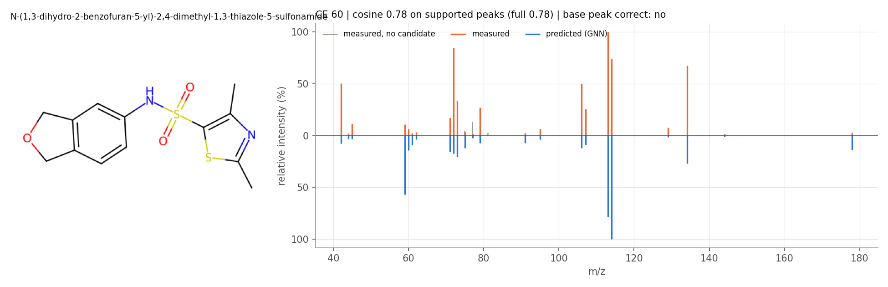
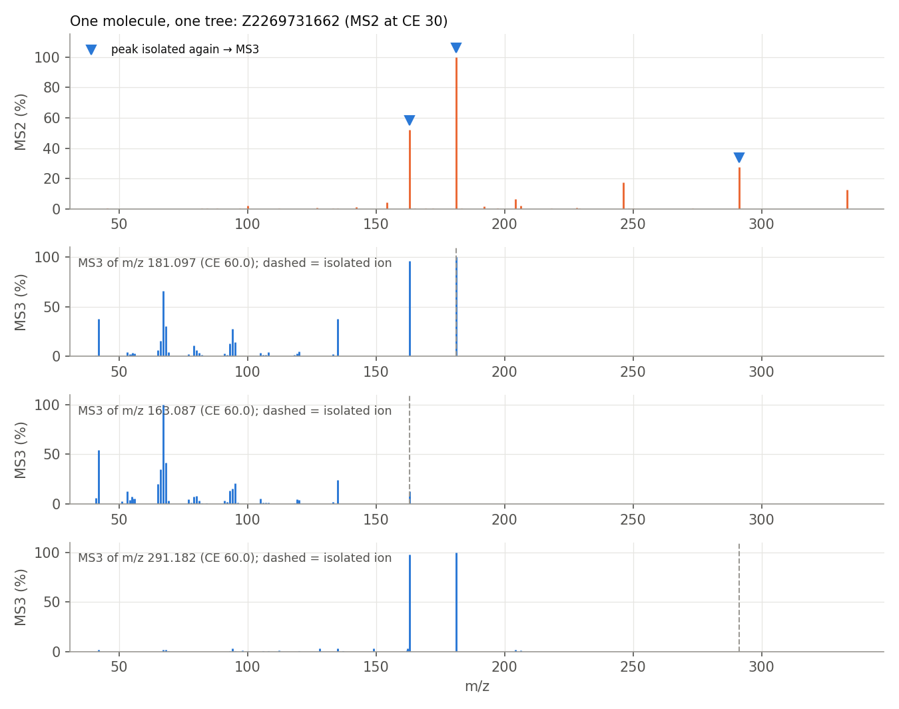
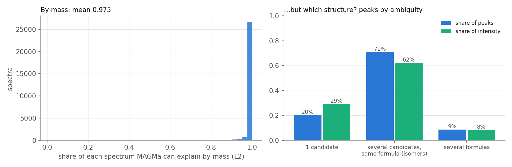
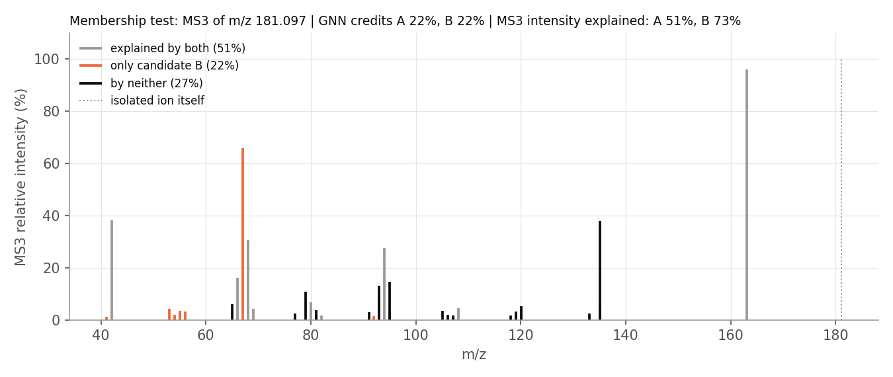
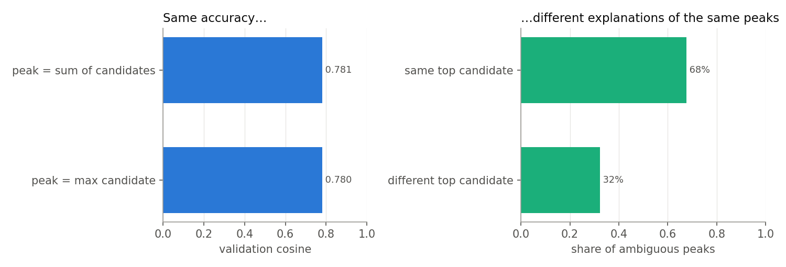
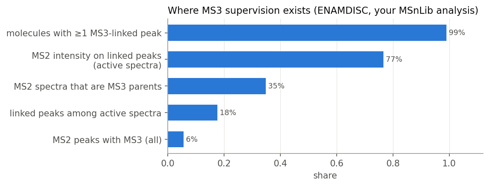

# Brainstorm: five open questions, from MSnLib to MS3

All figures use validation molecules. The test set is untouched. Generated by `make_figures.py` and
`make_figures_v2.py`.

**Calibration: what our current model's accuracy looks like.** This is a spectrum at the typical
score (cosine 0.78; median over validation spectra 0.84).

---

## 1. What is the right "ground truth" object: a spectrum, or a fragmentation tree?

MSnLib gives *trees*: precursor → fragment → sub-fragment, at several energies. So far we've learned
MS2 alone and treated MS3 as an add-on.

- Should we learn a probabilistic fragmentation graph (ions, transitions, energy dependence), with
  MS2 / MS3 / MS4 as partial views of it?
- Then consistency between levels becomes a training signal in its own right.
- Which parts are learnable (e.g. transition rates from 3 energies) and which only measured?

*One real tree.* The MS3 of 291 contains 181 and 163, and the MS3 of 181 contains 163, so the chain
291 → 181 → 163 is visible directly. An MS2 spectrum mixes all of these generations together.

## 2. Is bond-breaking the right hypothesis space, or do we need rearrangements and mechanisms?

MAGMa explains 97.5% of each spectrum *by mass*. But 71% of peaks (62% of intensity) have several
**same-formula** candidates, so mass alone can never pick the structure. In the MS3 example below,
27% of the MS3 intensity is explained by *no* candidate.

- How do we know whether the true fragment is even in the candidate set? Is MS3 the audit tool?
- Mechanism- or rule-based generators (charge-directed cleavage, rearrangement templates) or learned
  transitions (CFM-ID-style)?
- A richer space covers more of the truth but adds ambiguity and makes the problem less identifiable.
  Where is the balance, and how do we measure it?

## 3. Given a very good intensity predictor, how do we test whether a candidate is really in an MS3?

Options to discuss:
- **Model comparison:** likelihood of the measured MS3 if the isolated ion is *c*, vs. alternatives.
  What's the null: noise, co-isolation in a 1–2 Da window, other isomers?
- **Mixture deconvolution:** measured MS3 = a non-negative mix of each candidate's predicted MS3,
  measured at 3 energies.
- **Bayesian:** MS2-model share as the prior, MS3 as the evidence, giving a posterior per candidate.
- What metric, and how do we control false memberships across ~45k linked peaks?
- Does a predictor trained on whole-molecule MS2 transfer to fragment ions as precursors?

*A real case, the first suitable validation tree, not cherry-picked.* The peak has 6 candidates and the
GNN is undecided (A 22%, B 22%). Simple sub-fragment matching already separates them: B explains
73% of the MS3 intensity, A 51%. 27% fits neither.

## 4. What does an intensity predictor need to "understand", and how would we know it does?

Two models with the same accuracy explain the same peaks differently. Cosine cannot tell us
whether the model knows *which* fragment formed.

- Predict per-candidate *rates* with explicit energy dependence (breakdown curves, kinetics)
  instead of a softmax over peaks?
- How much error comes from unobserved factors: label noise, consecutive fragmentation, instrument,
  competing pathways?
- Which evaluations go beyond cosine (attribution accuracy against MS3, counterfactual CE,
  unseen chemotypes)?

*Same validation cosine (0.781 vs 0.780), but the two models pick the same top candidate in only 68%
of ambiguous peaks.*

## 5. What is the end goal, and does each piece serve it?

Forward prediction, annotation of measured spectra, an MS3-verified dataset of fragment identities,
or a self-improving loop (MS2 model → candidate posteriors → MS3 verification → retrain)? Which is
the paper, and which experiment would convince a skeptical reviewer? Does anything learned with MS3
transfer to MS2-only data such as NIST, where most real use is?

*MS3 reaches almost every molecule and most of the intensity, but only a few percent of peaks.*
Source: Docs/MSnLib_Analysis.pdf.
