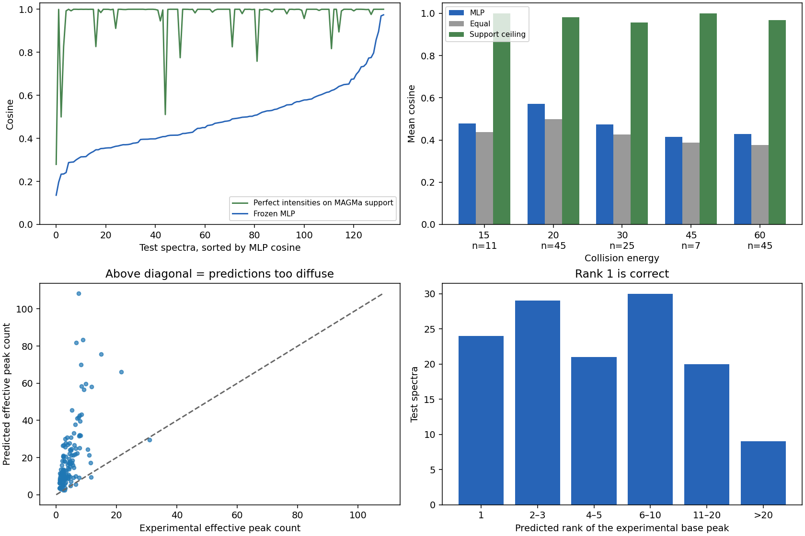
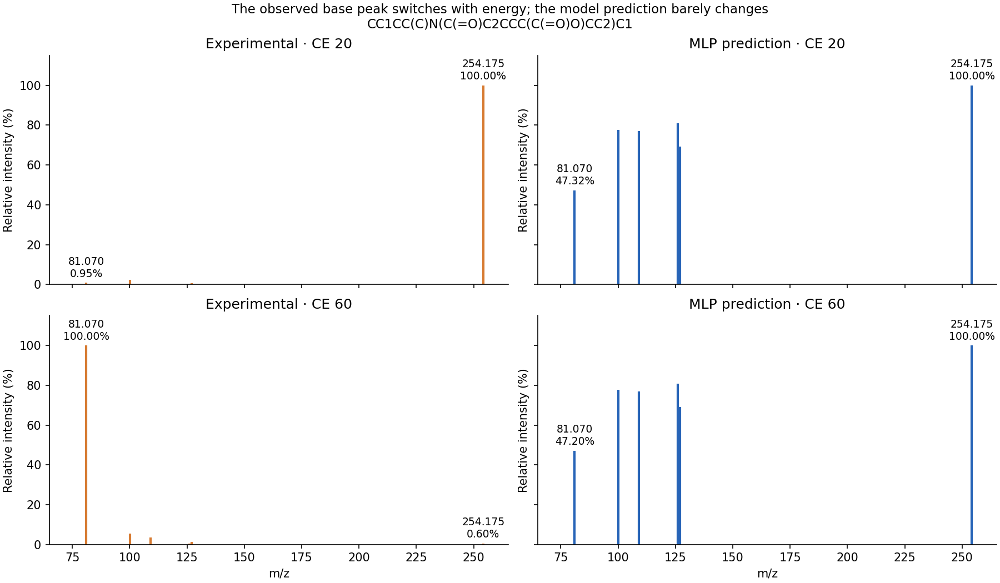
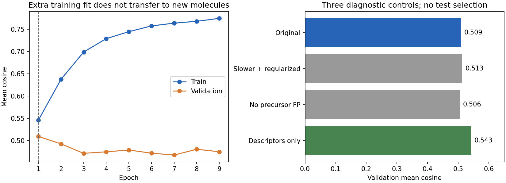

# Why Experiment 2 only reaches 0.488 test cosine

**The main failure is the learned intensity distribution. MAGMa supplies enough peak locations for much higher scores.** The current model almost ignores collision energy, spreads intensity across too many peaks, and overfits a small set of training molecules. A separate mass-matching issue also forces some neighboring peaks to have identical predictions.

This audit uses the existing 300-molecule / 890-spectrum sample and frozen checkpoint. Original training code, weights and reported results were preserved. Three small diagnostic controls used validation only; they were not evaluated on test.

## 1. Missing MAGMa peaks explain little of the average error

For each spectrum, I assigned its **true experimental intensity** to every supported peak and zero elsewhere. This is an optimistic diagnostic bound, not a usable predictor:

`support ceiling = ||experimental intensities at supported peaks||₂ / ||all experimental intensities||₂`

| Frozen-model diagnostic | Validation | Test |
|---|---:|---:|
| Actual mean cosine | 0.5095 | 0.4882 |
| Perfect intensities on existing MAGMa support | 0.9792 | 0.9745 |
| Cosine considering supported locations only | 0.5220 | 0.5025 |
| Experimental strongest peak has a candidate | 95.4% | 97.0% |
| Model correctly ranks the strongest peak first | 22.9% | 18.0% |

On test, the gap to 1 decomposes exactly into **0.0255 from unavailable support** plus **0.4863 from intensity shape on available support**. Thus roughly **95% of this gap remains inside the supported peaks**. This is an algebraic decomposition, not proof that each supplied fragment structure is correct.

Even among the 113 test spectra with support ceilings above 0.99, the model averages only **0.495**. Better fragment coverage alone will not fix this model.

## 2. The model effectively ignores collision energy

Holding every test candidate and its features fixed except energy, changing **CE 20 → 60** produces:

- Mean cosine between the two predictions: **0.9999991**.
- Mean absolute intensity change: **0.000652 on the 0–1 scale**, or **0.065 percentage points**.

Real spectra change much more. Across 103 same-molecule, different-energy test pairs with at least five common supported peaks, experimental cosine averages **0.602**, while predicted cosine averages **0.999997**. Matching is one-to-one nearest mass within `max(0.005 Da, 20 ppm)`. These common axes retain a median 99.1% / 98.9% of the two spectra's squared intensity, and 99.2% of matched bags have identical feature rows except energy.

A concrete CE20/60 case shows the problem:

| Peak m/z | Experimental CE20 | Experimental CE60 | Predicted CE20 | Predicted CE60 |
|---|---:|---:|---:|---:|
| 81.0695 | 0.95% | 100.00% | 47.32% | 47.20% |
| 254.175 | 100.00% | 0.60% | 100.00% | 100.00% |

The observed strongest peak switches; the prediction barely moves. Both scans have the same feature ID, precursor m/z, [M+H]+ adduct and Orbitrap ID-X instrument. The 254.175 peak is the precursor: its measured intensity falls to 0.60% at CE60, but the model still makes it the base peak. The plot shows their shared supported peaks, retaining 99.97% / 91.36% of squared experimental intensity. This example was selected to illustrate a pronounced failure, not as a random sample.

Energy is present in the input, but the fitted model has not learned its interaction with fragment structure. The scalar energy feature competes with 1,024 fingerprint dimensions; insufficiently learned interactions are a plausible explanation, not an architectural impossibility established by this audit.

## 3. Predictions are too diffuse, and additional training overfits

On test, the experimental spectrum has a mean **4.54 effective peaks**, versus **20.08** predicted. Effective peak count is `(sum intensity)² / sum(intensity²)`: one dominant peak gives approximately 1, while equal intensity at N peaks gives N. The model assigns substantial intensity to many weak experimental peaks and gets the base peak wrong in **82%** of spectra.

The MLP has **140,545 parameters**, trained on **210 molecules / 626 spectra**. Its 68,220 training candidate rows are alternative explanations for 13,152 supported peak rows, not independent intensity labels.

| Original checkpoint | Train cosine, evaluated after epoch | Validation cosine |
|---|---:|---:|
| Epoch 1, saved | 0.5461 | 0.5095 |
| Epoch 3 | 0.6991 | 0.4715 |
| Epoch 9 | 0.7749 | 0.4751 |

The model fits training spectra increasingly well, but that fit does not transfer to new molecules. Longer training alone is not supported as a remedy.

I reproduced the original selected weights **bit for bit**, and reproduced its entire logged training/validation history exactly. Max aggregation and checkpoint selection are working as implemented.

## 4. Small controls implicate the feature/training setup

These three controls retain the same data, split, seed, max pooling and cosine loss. They use at most 40 epochs, with validation early stopping. Removing a fingerprint means zeroing those columns, preserving the architecture.

| Diagnostic model | Validation mean cosine | Selected epoch |
|---|---:|---:|
| Original | 0.5095 | 1 |
| Lower learning rate + weight decay | 0.5133 | 8 |
| Remove precursor fingerprint | 0.5061 | 1 |
| Keep only the eight energy/structure descriptors | **0.5429** | 40 |

The descriptor-only control also changes intensities by **8.24 percentage points** for CE20→60 on validation, versus **0.072** for the original. This supports simplifying or regularizing the fingerprint mapping and improving energy conditioning. It does not prove that fingerprints are useless or that the control has learned correct chemistry. The descriptor-only run reaches its epoch limit; its convergence and independent test improvement remain untested. Lower learning rate and weight decay were changed together, so their individual effects are not isolated.

## 5. A real assignment problem: identical candidates at neighboring peaks

The matcher accepts every observed peak within `max(0.005 Da, 20 ppm)` of a theoretical mass. At low m/z, the fixed 0.005 Da floor is wide enough to attach the same candidate to multiple centroids. Observed mass error is not a model feature, so identical candidate sets must produce identical intensities.

Fresh MAGMa regeneration confirmed this example: the **same C4H5+ candidate**, theoretical m/z **53.03857658**, appears at all four locations:

| Observed m/z | Mass error (ppm) | Experimental intensity | Predicted intensity |
|---|---:|---:|---:|
| 53.035224 | −63.21 | 0.006 | 0.521 |
| 53.038414 | −3.07 | 1.000 | 0.521 |
| 53.041500 | +55.12 | 0.026 | 0.521 |
| 53.042976 | +82.95 | 0.023 | 0.521 |

**49/133 test spectra** contain at least one indistinguishable set of neighboring peak inputs. Enforcing equal outputs for these sets lowers the optimistic mean ceiling from **0.9745 to 0.9586**. This is a concrete limitation, but still leaves a large gap above 0.488. The bound accounts only for these equality constraints, not all constraints of the neural network. The audit does not establish whether each neighboring centroid is noise or a different real ion.

This is distinct from duplicate fragments inside a bag: no duplicate complete feature rows were found within bags among 100,289 candidate rows.

## What this means, and the next changes to test

MAGMa supplies **hypotheses at possible peak locations**, not verified fragment identities or their production probabilities. Test bags average 5.21 candidates; 72.6% of supported peaks are ambiguous. Hard max gives direct intensity gradients only to current winners—19.3% of training candidate rows at the saved checkpoint. That is the requested behavior, not an aggregation bug. Candidate count has essentially no correlation with test cosine here, so this audit does not establish ambiguity as the dominant cause.

The evidence supports these next steps, keeping the model small and max aggregation intact:

1. **Make energy conditioning explicit.** Test energy × fragment descriptors or a small energy-conditioned scoring head. Require a measured response on fixed candidates and improvement on validation.
2. **Reduce and regularize the fingerprint branch; expand distinct training molecules.** The current 210-molecule training sample is too limited to establish a strong structure-to-intensity predictor. The simpler control is a useful reference.
3. **Resolve neighboring-centroid ambiguity using mass information.** Test nearest-mass assignment or mass-error features and an instrument-appropriate window. Inspect cases before merging centroids; identical structures should not be forced to explain four different intensities through identical inputs.

No GNN, Glacier, or microstate enumeration is needed to test these changes. A substantially higher score is plausible given the support bound, but **0.975 is an oracle ceiling, not a promised attainable score**.

The current model's improvement over equal intensity is small but consistent in a molecule-cluster bootstrap: test mean-cosine improvement **+0.055**, with approximate 95% interval **+0.034 to +0.078**. This describes the existing sample, not an independent replication. Future model selection should use validation, followed by a fresh untouched evaluation set when confirming the conclusions from this error analysis.

## Reproduction and detailed evidence

- [Per-spectrum measurements](error_analysis/per_spectrum.csv) and [aggregate diagnostics](error_analysis/diagnostics.json).
- [Feature and energy audit](error_analysis/feature_audit.json), [verified matching example](error_analysis/tiebag_example.json).
- [Training audit](error_analysis/training_audit.md) and [complete control results](error_analysis/training_audit.json).
- Additional individual cases: [poor prediction despite complete support](error_analysis/worst_supported.png), [missing-support failure](error_analysis/largest_support_loss.png), [typical error](error_analysis/typical_error.png), [good prediction](error_analysis/best_prediction.png).

Run the scripts in `error_analysis/` with the repository's `.venv/bin/python`: `analyze.py`, `feature_audit.py`, `training_audit.py`, then `plot_findings.py`. Only `training_audit.py` repeats the bounded diagnostic training. These scripts write diagnostic artifacts; the original model and metrics remain unchanged. A separate source-record check also confirmed all 300 InChIKey connectivity groups remain disjoint across splits.
