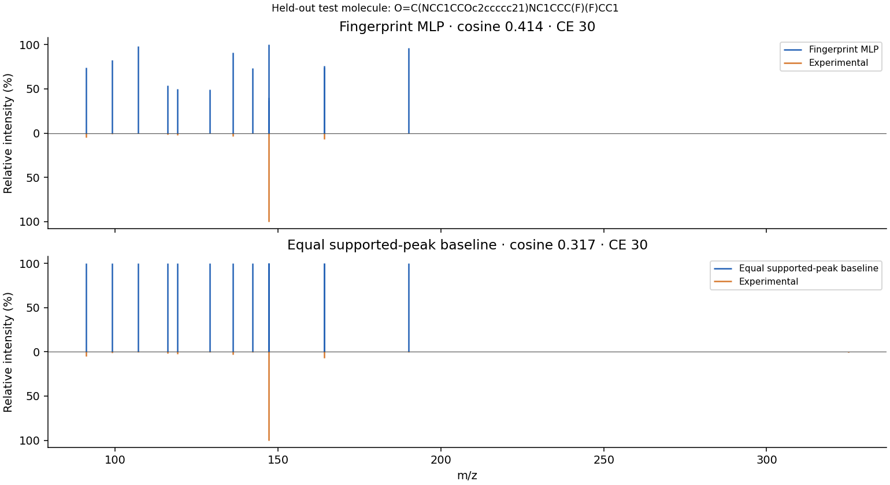
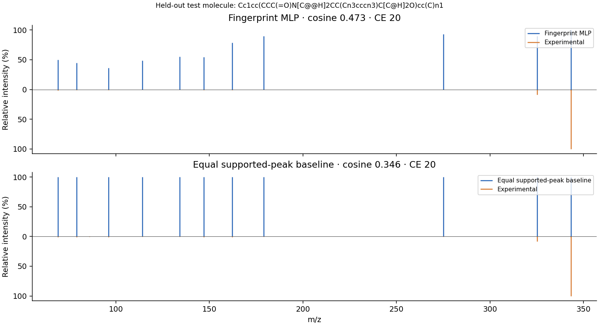
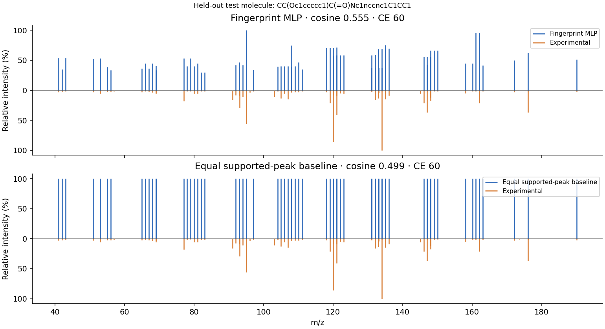

# MAGMa intensity-only proof of concept

Seed 20260922; {'train': 210, 'validation': 45, 'test': 45} molecules and {'train': 626, 'validation': 131, 'test': 133} spectra.
Source: `20241003_enamdisc_pos_msn.json`. The manifest records selection, offsets, exclusions and generation failures.
Preparation recorded 0 errors and retained 0 completely unsupported spectra.
Canonical non-stereochemical precursor SMILES define disjoint 70/15/15 molecule splits.
This bounded sample uses ordinary single-scan MS2, scalar collision energy, singly positive
supported adducts and connected precursors with at most 35 heavy atoms. Up to three energies per molecule.

The model concatenates radius-2 512-bit Morgan fingerprints for precursor and fragment
with eight explicit energy/structure descriptors. Its 128/64-unit MLP produces positive
candidate scores using Softplus. Exact heavy graph + formula + charge duplicates are removed
within a peak. **Peak intensity is the maximum candidate score**, keeping alternative
identities latent. Training uses only spectrum cosine loss (Adam, lr 0.001, batch 16).
No experimental intensity, quality score or peak rank is an input. MAGMa peak positions
come from observed masses; no Glacier, state enumeration or MS3 enters this experiment.

Fragment fingerprints use the supplied heavy graph with implicit H disabled and non-strict
property caching, without ionic sanitization or chemistry repair. Total H and charge are
separate descriptors. This can represent imperfect MAGMa graphs without claiming a valid ionic state.
Identical precursor/charge/mass records reuse MAGMa enumeration on their union of observed
mass locations; each spectrum retains its own original peak axis and separate target intensities.

## Held-out results

| Split | Predictor | Mean cosine | Median cosine | MAE | Cosine > 0.5 | Cosine > 0.7 |
|---|---|---:|---:|---:|---:|---:|
| validation | fingerprint_mlp | 0.5095 | 0.4945 | 0.3315 | 0.4885 | 0.1603 |
| validation | equal_intensity | 0.4561 | 0.4293 | 0.6382 | 0.3053 | 0.0916 |
| test | fingerprint_mlp | 0.4882 | 0.4733 | 0.3078 | 0.4135 | 0.0827 |
| test | equal_intensity | 0.4329 | 0.4100 | 0.6004 | 0.2256 | 0.0376 |

Each spectrum has equal weight. Cosine uses every observed peak, assigning zero to
unsupported locations; completely unsupported spectra score zero. MAE uses independently
base-peak-normalized [0,1] vectors and is averaged per spectrum, then across spectra.
The baseline assigns one to every supported peak regardless of candidate count.

Best validation checkpoint: epoch 1 of 9; training 0.6s on CPU (2 threads).
Later checkpoints did not exceed that validation score; the saved model is the selected checkpoint, not the last epoch.
Training loss continued falling while validation scores declined, indicating early overfitting on this small sample.
Test mean-cosine difference from the equal-intensity baseline: +0.0554.
Test spectra were evaluated only after selection. This is a small, single-seed conditional
intensity experiment, not a measure of peak discovery or fragment identity accuracy.
No hyperparameter search or large experiment was run.

## Examples and reproduction

The first three distinct test molecules were chosen without examining scores.
Predictions are above zero and experimental peaks below; both sides use the same m/z axis.

Open `../../Experiment_2.ipynb`, or run `.venv/bin/python train_intensity.py` from the repo root.
`dataset.pkl` is a generated local cache, `manifest.json` audits the sample, `model.pt`
contains the selected weights, and `metrics.json` contains metrics and training history.
Inference: `intensity_model.predict_spectrum(model, smiles, collision_energy, bags)`.
