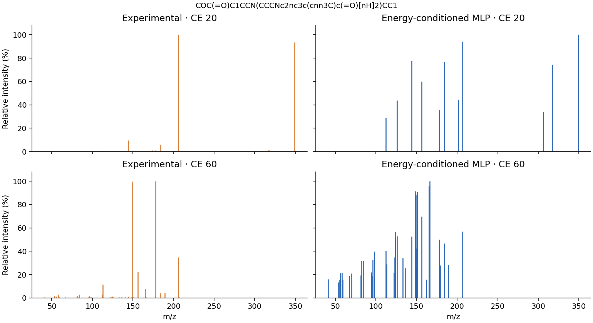
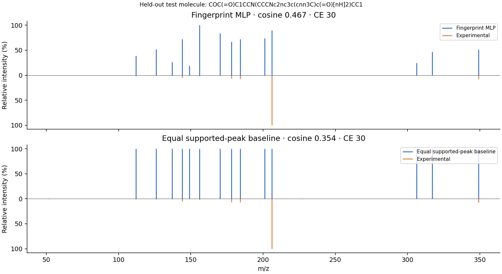
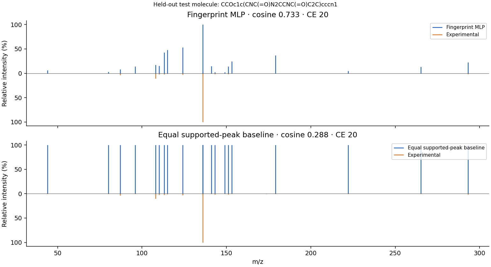
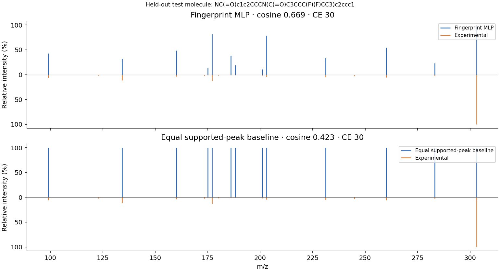

# Improved MAGMa intensity-only model

On the same fresh test cohort, the small fingerprint model reaches **0.5871 mean
cosine**, versus **0.5092** for the frozen old model. The descriptor-only baseline
reaches **0.5961**, slightly better on both validation and test. Its weights are
available separately as `descriptor_model.pt`. Both checkpoints were selected using
validation. No test-driven hyperparameter changes were made.

The same latent max aggregation and full-spectrum cosine loss are retained.
The sample contains {'train': 1050, 'validation': 225, 'test': 225} molecules and {'train': 3133, 'validation': 672, 'test': 668} spectra.
All 300 previously examined molecules and equivalent InChI connectivity identities are excluded.
Train/validation/test remain molecule-disjoint; the frozen old model is evaluated on the **same fresh test spectra**.

Nearest assignment uses mass alone: a canonical fragment graph/formula/charge goes to one
closest observed centroid within its existing MAGMa matches. Ties prefer lower m/z then
original order. Assignment occurs separately for each scan after union generation, so CE
scans cannot steal one another's candidates. Empty bags remain zero predictions.

The model has 7,139 parameters versus 140,545 previously.
It uses 20 structural/mass-error descriptors, a downweighted 16-unit fingerprint projection
(128 bits each for precursor and fragment), and a 48/24-unit MLP. Its three outputs are
fragment-specific coefficients of `a + b E + c E²`, with `E=(CE−40)/20`; Softplus converts
this to positive candidate intensity. Thus energy interacts explicitly with fragment features.
The FP branch uses dropout0.15; AdamW uses weight decay0.01 and lr0.002. No intensity labels
enter features. No Glacier, microstate enumeration, GNN or new framework is used.

Both models were fixed before test evaluation. Validation selected epochs {'energy_mlp': 5, 'descriptor_only': 88}.
The descriptor-only baseline retains the same conditioning but omits the fingerprint branch.

## Fresh held-out test results

| Model / support | Mean cosine | Median | >0.5 | >0.7 | Effective peaks | Strongest peak |
|---|---:|---:|---:|---:|---:|---:|
| energy_mlp | 0.5871 | 0.5813 | 62.1% | 31.1% | 12.48 | 30.7% |
| descriptor_only | 0.5961 | 0.5996 | 65.7% | 31.6% | 12.62 | 31.7% |
| old_original_support | 0.5092 | 0.5009 | 50.3% | 12.1% | 18.22 | 19.2% |
| old_nearest_support | 0.5108 | 0.5016 | 50.7% | 12.1% | 17.76 | 19.2% |
| equal_nearest_support | 0.4594 | 0.4414 | 34.1% | 8.4% | 21.26 | 9.1% |
| equal_original_support | 0.4556 | 0.4380 | 33.2% | 7.9% | 21.84 | 8.9% |

Experimental effective peak count: **4.54**.
Effective count is `(sum I)² / sum(I²)`, averaged per spectrum. Strongest-peak accuracy
uses fractional credit among exactly tied predicted maxima (uniform tie breaking); a zero
prediction gets zero credit. This matters particularly for the equal-intensity baseline.
All observed peaks contribute, with zero predictions for unsupported locations. Metrics
macro-average across spectra. Normalized MAE is also retained in `metrics.json`.

`old_original_support` is the old checkpoint and old matching. `old_nearest_support`
isolates the matching change with its weights frozen. Both equal baselines show support effects.
These fresh-cohort numbers should be compared within this table, not directly against the
earlier 45-molecule test cohort. Nearest/support oracle cosines are
0.9630/0.9633.

## Collision-energy response

Hold each candidate set fixed and change only CE20→CE60. Energy interactions are recomputed.
Zero/single-supported-peak spectra are excluded because their normalized shape cannot change.
Smaller prediction cosine indicates more shape change, not necessarily better chemistry.

| Model | CE20/60 prediction cosine | Mean absolute intensity change (percentage points) |
|---|---:|---:|
| energy_mlp | 0.889738 | 12.556 |
| descriptor_only | 0.776487 | 15.503 |
| old_original_support | 0.999999 | 0.075 |
| old_nearest_support | 0.999999 | 0.073 |
| equal_nearest_support | 1.000000 | 0.000 |

First test molecule with both energies, selected without scores:

## Validation and examples

| Model / support | Mean cosine | Median | >0.5 | >0.7 | Effective peaks | Strongest peak |
|---|---:|---:|---:|---:|---:|---:|
| energy_mlp | 0.5811 | 0.5671 | 61.3% | 31.4% | 12.63 | 31.4% |
| descriptor_only | 0.5971 | 0.5879 | 66.1% | 31.4% | 13.20 | 33.6% |
| old_original_support | 0.5177 | 0.5083 | 51.3% | 13.8% | 19.10 | 21.6% |
| old_nearest_support | 0.5199 | 0.5119 | 52.1% | 13.8% | 18.62 | 21.6% |
| equal_nearest_support | 0.4631 | 0.4461 | 36.0% | 7.9% | 22.41 | 9.2% |
| equal_original_support | 0.4583 | 0.4403 | 34.5% | 7.7% | 23.01 | 9.0% |

The first three distinct test molecules were chosen without examining scores.

Run `.venv/bin/python train_intensity_v2.py` or open `../../Experiment_2.ipynb`.
`intensity_model_v2.predict_spectrum(model, smiles, collision_energy, bags)` performs
nearest assignment and prediction. The original checkpoint and published old-cohort
artifacts remain available under `../experiment_2/`.

The improvements bundle more training molecules, nearest matching, explicit energy
conditioning and regularization; this run does not isolate every change's contribution.
The frozen-old-model nearest-support row isolates matching alone. Predictions remain
too diffuse: 12.48 effective peaks versus 4.54 experimentally (old model: 18.22).
The descriptor baseline is slightly stronger than the fingerprint branch on this run.
This remains intensity prediction conditional on observed MAGMa-supported peak locations,
not peak discovery.
